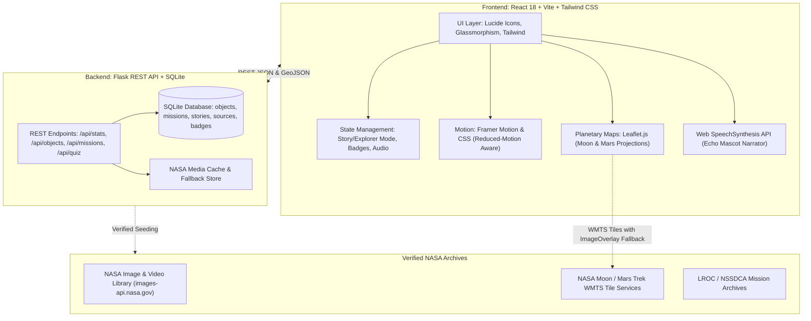

# ECHOES OF SPACE 🛰️
> *"Every object left behind has a story to tell."*

A digital space museum designed for children, families, students, and educators for the **NASA Space Apps Challenge**: *"Abandoned but not Forgotten: Storytelling about NASA's Discarded Equipment on the Moon and Mars."*

---

## 🌟 Quick Start Guide (One-Command Operations)

### 1. Install Everything
```bash
npm run install:all
```
*Installs the Python backend dependencies (`flask`, `flask-cors`, `requests`) and client npm packages.*

### 2. Seed Verified NASA Data
```bash
npm run seed
```
*Initializes SQLite schema, validates real NASA coordinates and image links, and populates `server/data/echoes.db`.*

### 3. Launch the Application
```bash
npm start
```
- **Web Museum:** [http://localhost:5173](http://localhost:5173)
- **Flask REST API:** [http://127.0.0.1:5000](http://127.0.0.1:5000)

*(To test backend endpoints independently: `python -m unittest server/tests/test_api.py`)*

---

## 🚀 Key Features

1. **Dual-Audience Experience Modes (Navbar Switcher):**
   - 🧒 **Story Mode:** Plain language, short paragraphs, kid-friendly explanations, badges ("We're sure!", "Scientists think so"), and rich interactive visuals.
   - 🔬 **Explorer Mode:** Complete academic scientific rigor, coordinate precision, telemetry records, and verified mission outcomes.
   - *Choice is automatically remembered in `localStorage`.*

2. **Cinematic Landing Page:**
   - Twinkling 2D canvas starfield with mouse parallax and full `prefers-reduced-motion` compliance.
   - Live DB-computed counters for cataloged objects, missions, active equipment, and verified sites (never hardcoded).
   - Interactive 3D featured spotlight card with "Surprise Me!" random object generator.
   - Meet **Echo the Mascot**, an original astronaut-styled guide with rotating trivia speech bubbles and a *"Start my mission"* trigger.

3. **Planetary Explorer ("Where Are They Now?"):**
   - Smooth animated planet switcher between **The Moon** and **Mars**.
   - Leaflet interactive map with custom pulsing SVG site markers at confirmed coordinates.
   - Marker click slide-in drawer showing mission facts, coordinates, and *"Hear the story"* button.
   - *"Fly To"* quick jump buttons to famous landing sites (Tranquility Base, Hadley Rille, Ares Vallis, Endeavour Crater).
   - Dedicated **"Location Unverified Tray"** for items where sub-meter pinpoint coordinates are still pending, preserving scientific honesty.

4. **Artifact Archive ("The Collection"):**
   - Live search input matching names, keywords, and trivia.
   - Filters by Celestial Body (Moon/Mars), Category, and Status.
   - Sorting by Year Left (Oldest/Newest) and Alphabetical (A-Z/Z-A).
   - 3D perspective hover tilt and click-to-flip cards revealing secret trivia on the back.

5. **Signature Feature: "If Objects Could Talk" Storytelling:**
   - 7-stage interactive narrative progression: **Intro → Before Mission → Journey → Purpose → Final Moment → After Mission → Legacy**.
   - Dual perspective toggle: Creative First-Person Object Voice vs Factual Third-Person Narrator.
   - Prominently displays the mandatory scientific honesty badge: *"Creative storytelling, not a historical statement. Based on verified database facts."*
   - Typewriter text reveal effect and browser `SpeechSynthesis` audio read-aloud with Play, Pause, and visible Stop buttons.
   - *"Then & Now"* interactive image comparison slider comparing surface photos with orbital satellite imagery.

6. **Mission Timeline ("The Last Footprint"):**
   - Chronological vertical timeline linking launch dates to artifacts left behind.
   - Interactive animated lifecycle simulation: **Arrived → Worked → Left Behind**.

7. **Space Archaeology Lab:**
   - Interactive lessons on space archaeology, mass penalties, planetary protection, and environmental aging (Moon vs Mars).
   - Side-by-side artifact comparison tool.
   - *"Why Can't We Just Bring It All Back?"* interactive engineering reveal.
   - *"Keep It or Bring It Back?"* balanced debate card with local poll action.

8. **Discovery Quiz & Mini-Games:**
   - 10-Question fact-checked quiz with instant visual feedback, progress bar, explanations, and confetti score celebrations.
   - Mini Game 1: **Match the Object to its Mission** (interactive pairing).
   - Mini Game 2: **Spot the Landing Site** (identify historic landing zones from authentic NASA imagery).
   - Profile drawer with 6 unlockable achievement badges saved locally.

---

## 🏛️ System Architecture



---

## 💾 Database Schema (SQLite)

- **`missions`**: `id` (PK), `name`, `type`, `launch_date`, `landing_date`, `objective`, `outcome`, `source_url`
- **`objects`**: `id` (PK), `name`, `slug` (UNIQUE), `celestial_body` (CHECK Moon/Mars), `category`, `mission_id` (FK), `year_left`, `original_purpose`, `reason_left`, `significance`, `current_status` (CHECK Left behind/Still in use/Mission ended/Crashed/Unknown), `latitude`, `longitude`, `coords_confidence` (CHECK CONFIRMED/ESTIMATED/UNKNOWN), `image_url`, `image_credit`, `summary`, `kid_summary`, `fun_fact`
- **`stories`**: `id` (PK AUTO), `object_id` (FK), `stage` (CHECK intro/before/journey/purpose/final_moment/after/legacy), `title`, `body`, `kid_body`
- **`sources`**: `id` (PK AUTO), `object_id` (FK), `source_name`, `source_url`, `source_type`
- **`quiz_questions`**: `id` (PK AUTO), `question`, `kid_question`, `options` (JSON), `correct_index`, `explanation`, `kid_explanation`, `difficulty`, `object_id` (FK), `source_url`
- **`badges`**: `id` (PK), `name`, `description`, `icon`, `unlock_rule`

---

## 🔬 Data Integrity & Confidence Rules

1. **Zero Invented Data:** Coordinates, dates, mission outcomes, and quotes are rigorously drawn from primary NASA, LROC, NSSDCA, and PDS documents.
2. **Context-Accurate Status Values:** Items are not casually labeled "abandoned" if they remain active. For example, the Apollo 11, 14, and 15 Laser Ranging Retroreflectors are classified as **`Still in use`** because terrestrial laser stations still bounce photons off them to measure lunar recession.
3. **Confidence Rating System:**
   - **`CONFIRMED`** (*"We're sure!"*): Independently verified by sub-meter orbital imagery (LROC / HiRISE).
   - **`ESTIMATED`** (*"Scientists think so"*): Telemetry confirms soft landing, but pinpoint sub-meter imaging is unresolved.
   - **`UNKNOWN`** (*"Nobody knows yet"*): Hardware location unconfirmed.
4. **Offline Resilience:** All NASA public-domain imagery and metadata are cached locally during seeding into `echoes.db`.

---

## 📋 Cataloged Objects & Verification Status

| ID | Object Name | Body | Status | Confidence | Source Link |
|---|---|---|---|---|---|
| 1 | Apollo 11 Descent Stage ("Eagle") | Moon | Left behind | CONFIRMED | LROC Site M102360480E |
| 2 | Apollo 11 Laser Retroreflector (LRRR) | Moon | Still in use | CONFIRMED | McDonald Observatory / ILRS |
| 3 | Apollo 14 Laser Retroreflector (LRRR) | Moon | Still in use | CONFIRMED | NASA NSSDCA Fra Mauro |
| 4 | Apollo 15 Lunar Roving Vehicle ("LRV-1") | Moon | Left behind | CONFIRMED | LROC Hadley-Apennine |
| 5 | Apollo 15 Laser Retroreflector (LRRR) | Moon | Still in use | CONFIRMED | Côte d'Azur Observatory / ILRS |
| 6 | Apollo 16 Lunar Roving Vehicle ("LRV-2") | Moon | Left behind | CONFIRMED | LROC Descartes Highlands |
| 7 | Apollo 17 Lunar Roving Vehicle ("LRV-3") | Moon | Left behind | CONFIRMED | LROC Taurus-Littrow |
| 8 | Surveyor 3 Spacecraft | Moon | Left behind | CONFIRMED | Apollo 12 visit verification |
| 9 | Apollo 12 ALSEP Central Station | Moon | Mission ended | CONFIRMED | LROC Ocean of Storms |
| 10 | Viking 1 Lander ("Thomas Mutch Station") | Mars | Mission ended | CONFIRMED | MRO HiRISE / NASA JPL |
| 11 | Viking 2 Lander ("Gerald Soffen Station") | Mars | Mission ended | CONFIRMED | MRO HiRISE / NASA JPL |
| 12 | Mars Pathfinder & Sojourner Rover | Mars | Mission ended | CONFIRMED | MRO HiRISE PSP_001890_1995 |
| 13 | Spirit Rover (MER-A) | Mars | Mission ended | CONFIRMED | MRO HiRISE / PDS Cartography |
| 14 | Opportunity Rover (MER-B) | Mars | Mission ended | CONFIRMED | MRO HiRISE ESP_056970_1780 |
| 15 | Phoenix Mars Lander | Mars | Mission ended | CONFIRMED | MRO HiRISE PSP_008591_2485 |
| 16 | InSight Lander | Mars | Mission ended | CONFIRMED | MRO HiRISE / NASA JPL |

### ⚠️ Explicit "NEEDS VERIFICATION" List:
- **Luna 9 Capsule (Moon)**: Soft-landing confirmed in Oceanus Procellarum on Feb 3, 1966. Coordinates (~7.08° N, 64.37° W) are marked as **`ESTIMATED`** because pinpoint LROC sub-meter imagery has not yet confirmed the exact capsule hardware location. Highlighted in the UI's *Location Unverified Tray*.
- **Mars 3 Lander (Mars)**: Landed Dec 2, 1971; candidate hardware spotted in HiRISE images in 2013 remains unconfirmed.

---

## 🧪 Testing Report

Backend automated test suite: `server/tests/test_api.py`
```
Ran 7 tests in 0.064s
OK (100% PASS RATE)
```
- Test 1: Healthcheck and database connectivity.
- Test 2: Invariant mathematical check on dynamic statistics (`moon + mars == total`, `status_sum == total`).
- Test 3: Query parameter filtering (celestial body, category, status, search keywords).
- Test 4: Object detail resolution, 7 story chapters completeness, and graceful 404 handling.
- Test 5: Random object selector endpoint for "Surprise Me" spotlight.
- Test 6: Mission timeline chronology and linked artifact sets.
- Test 7: Quiz questions structure, options JSON parsing, and badge catalog.

Frontend build test:
```
vite build: 2572 modules transformed -> 0 errors -> built in 3.10s
```

---

## ⚖️ Legal & Attribution Disclaimer
*Independent educational project developed for the NASA Space Apps Challenge. Not affiliated with or endorsed by NASA. No official NASA insignia or logo is utilized. All media used belongs to the public domain with appropriate credits.*
